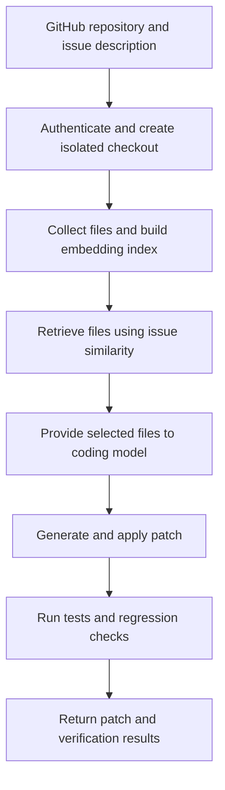

# Semantic File Retrieval for Coding Agents

## Project description

This project builds a standalone AI coding agent to investigate whether semantic retrieval of files from large codebases can effectively help solve project issues.

The agent connects to a GitHub repository and receives an issue description from the user. It searches the repository by semantic similarity to identify relevant files, supplies those files to a gemma 4  model, and understands the sematic meaning and  generates a proposed fix. The agent then runs tests to check whether the fix resolves the issue.

## Development workflow

1. **Connect to GitHub.** Authenticate, accept a repository and issue description, and create an isolated checkout for the task.
2. **Collect repository files.** Identify source files and tests, excluding generated files, dependencies, and build artifacts.
3. **Build a semantic index.** Generate embeddings from file contents and store them with file paths and repository revisions. Split large files into chunks when needed, while retaining their file identity.
4. **Retrieve relevant files.** Embed the issue description, search the index, and rank files by semantic similarity.
5. **Prepare the model context.** Supply the issue and selected file contents within the model's context budget.
6. **Generate and apply a fix.** Have the coding model produce a patch and apply it to the isolated checkout.
7. **Verify the fix.** Run relevant tests and regression checks, recording failures and the final patch.
8. **Evaluate the approach.** Compare semantic file retrieval with text search on held-out issues. Measure successful fixes, relevant-file coverage, context usage, retrieval time, and performance across repository sizes.

## Agent workflow

